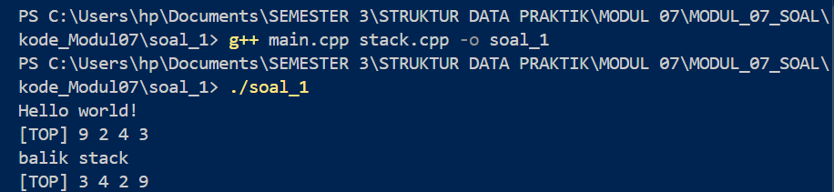
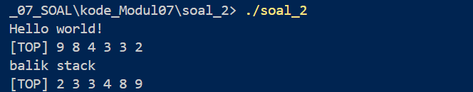
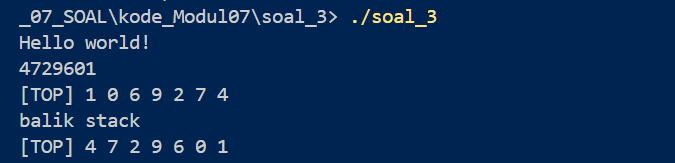

# <h1 align="center"> Modul 7 STACK </h1>
<p align="center">Muhammad Haidar Az Zacky - 109082530035</p>

## Dasar Teori

### A. Pengertian dan Komponen Stack

*Stack* (tumpukan) adalah struktur data yang prinsip operasinya seperti tumpukan benda: elemen yang bisa diambil lebih dahulu adalah elemen yang paling atas, yaitu elemen yang paling terakhir dimasukkan. Prinsip ini disebut **LIFO** (*Last In First Out*). Prinsip LIFO inilah yang membuat stack cocok untuk pekerjaan yang harus "mundur" dalam urutan terbalik, misalnya fitur *undo*, riwayat pemutaran lagu, evaluasi ekspresi matematika, dan pengelolaan memori [1][2][3].

Komponen stack pada dasarnya sama dengan *singly linked list*, hanya saja akses ke stack hanya dilakukan pada satu ujung, yaitu elemen paling atas yang ditunjuk oleh pointer `Top`. Karena itu dalam stack hanya ada satu pointer penunjuk (`Top`), tidak ada `First` dan `Last` seperti pada doubly linked list.

Deklarasi tipe stack dengan representasi pointer pada modul:

```C++
typedef int infotype;
typedef struct elmStack *address;
struct elmStack {
    infotype info;
    address next;
};

struct stack {
    address Top;
};
```

Stack kosong ditandai dengan `Top = Nil`.

### B. Operasi Stack Representasi Pointer

Ada dua operasi utama pada stack, yaitu *push* (penyisipan) dan *pop* (pengambilan).

**1. Push.** Push menyisipkan elemen baru di puncak stack dan sama dengan *insert first* pada list. Langkahnya: elemen dialokasikan terlebih dahulu (`P = alokasi(X)`, `P->next = Nil`), lalu disambungkan ke puncak lama dengan `P->next = S.Top`, dan terakhir puncak dipindah ke elemen baru dengan `S.Top = P`.

```C++
void push(address P) {
    P->next = S.Top;
    S.Top = P;
}
```

**2. Pop.** Pop mengambil elemen paling atas dan sama dengan *delete first* pada list. Langkahnya: `P = S.Top` untuk menyimpan elemen puncak, `S.Top = (S.Top)->next` untuk memindahkan puncak ke elemen di bawahnya, lalu `return P`.

```C++
address pop(address P) {
    P = S.Top;
    S.Top = (S.Top)->next;
    return P;
}
```

Kedua operasi hanya mengubah beberapa pointer di satu ujung, sehingga kompleksitasnya O(1) berapa pun jumlah elemen stack.

### C. Primitif-Primitif Stack

Primitif stack pada dasarnya sama dengan primitif list lainnya, tetapi lebih sedikit karena operasi hanya dilakukan pada elemen paling atas. Primitifnya adalah `createStack()`, `isEmpty()`, `alokasi()`, `dealokasi()`, fungsi-fungsi pencarian, dan fungsi primitif lainnya. Seperti model list yang lain, primitif ini disimpan dalam file `*.cpp` (realisasi) dan `*.h` (tipe dan prototipe).

### D. Stack Representasi Tabel (Array)

Prinsip stack dengan representasi tabel sama dengan representasi pointer. Perbedaannya ada pada struktur datanya: stack disimpan dalam *array* berindeks sehingga **jumlah tumpukannya terbatas** (kapasitas maksimum `Imax`). Pada representasi ini `Top` bukan pointer, melainkan angka yang menunjukkan indeks elemen paling atas. Stack kosong ditandai dengan `Top = 0`.

Operasi pada representasi tabel:

- **Push:** `Top` digeser ke indeks berikutnya (`Top = Top + 1`), lalu data disimpan pada posisi `Top`. Bila `Top` sudah sama dengan `Imax`, stack penuh dan data tidak bisa ditambahkan.
- **Pop:** data pada posisi `Top` diambil (`Temp = S.Info[Top]`), lalu `Top` bergeser ke indeks sebelumnya (`Top = Top - 1`). Data lama tidak dihapus secara fisik dari array, hanya tidak lagi dianggap bagian dari stack.
- Pada representasi tabel tidak diperlukan manajemen memori (`alokasi` dan `dealokasi`), sehingga primitifnya hanya `createStack()`, `isEmpty()`, fungsi pencarian, dan fungsi primitif lainnya.

### E. Perbandingan Representasi Pointer dan Tabel

| Aspek | Representasi Tabel (Array) | Representasi Pointer (Linked List) |
|---|---|---|
| Kapasitas | Tetap (`Imax`), bisa penuh | Dinamis, hanya dibatasi memori |
| Memori | Dialokasikan di awal | Dialokasikan per elemen (`new`) dan perlu dibebaskan |
| Penanda kosong | `Top = 0` | `Top = Nil` |
| Push dan Pop | O(1) | O(1) |
| Kelebihan | Sederhana, akses cepat, tanpa manajemen memori | Ukuran fleksibel |

Penelitian yang membandingkan keduanya menunjukkan bahwa array lebih efisien untuk akses data yang ukurannya tetap, sedangkan linked list unggul dalam fleksibilitas ukuran dan alokasi memori dinamis [1]. Pemilihan representasi bergantung pada kebutuhan aplikasi. Stack dan array juga dipakai pada kasus nyata, misalnya aplikasi pengurutan lagu yang menyimpan data lagu dalam array dan memakai stack untuk menyimpan indeks pada tiap iterasi [4], serta pengelolaan riwayat "Recently Played" pada pemutar musik [2].

## Guided

Pada bagian Guided, ADT Stack dibuat dengan **representasi tabel (array)** untuk data mahasiswa (`nim` dan `nama`) dengan kapasitas 10 elemen. Programnya terdiri atas tiga file: `stack.h`, `stack.cpp`, dan `main.cpp`.

### 1. Program stack.h

```C++
/* file : stack.h

#ifndef STACK_H_INCLUDED
#define STACK_H_INCLUDED

#include <iostream>
using namespace std;

struct infotype {
    char nim[20];
    char nama[20];
};
struct Stack {
    infotype info[10];
    int Top;
};

/* prototype */
/******** pengecekan apakah Stack kosong *********/
int isEmpty(Stack S);
/* mengembalikan nilai 0 jika stack kosong */

/******** pembuatan Stack ********/
void createStack(Stack &S);
/* I.S. sembarang
   F.S. terbentuk stack dengan Top=0 */

/******** penambahan elemen pada Stack ********/
void push(Stack &S, infotype X);
/* I.S. Stack mungkin kosong
   F.S. menambahkan elemen pada stack dengan nilai X, TOP=TOP+1 */

/******** penghapusan elemen pada Stack ********/
void pop(Stack &S, infotype &X);
/* I.S. stack tidak kosong
   F.S. nilai info pada indeks TOP disimpan pada X, kemudian TOP=TOP-1 */

/******** proses semua elemen Stack *********/
void viewStack(Stack S);
/* I.S. stack mungkin kosong
   F.S. jika stack tidak kosong menampilkan semua info yang ada pada stack
*/
#endif // STACK_H_INCLUDED
```
**Penjelasan:** *Header* ini adalah "kontrak" ADT stack representasi tabel.
- `#ifndef STACK_H_INCLUDED / #define STACK_H_INCLUDED / #endif` adalah *header guard* agar file tidak terbaca dua kali dalam satu program. Pada file ini juga ditulis `using namespace std;` sehingga `stack.cpp` dan `main.cpp` bisa langsung memakai `cout` dan `endl` tanpa awalan `std::`.
- `struct infotype` berisi dua *array of char*, yaitu `nim[20]` dan `nama[20]`. Karena berupa array karakter (string gaya C), pengisiannya memakai `strcpy`, bukan tanda `=`.
- `struct Stack` berisi `info[10]`, yaitu tabel yang menampung maksimal 10 elemen, dan `Top`, yaitu penanda jumlah elemen yang sedang terisi. Saat `Top = 0` stack kosong.
- Prototipe ada lima: `isEmpty`, `createStack`, `push`, `pop`, dan `viewStack`. Komentar I.S. (*Initial State*) dan F.S. (*Final State*) di bawah tiap prototipe menjelaskan kondisi sebelum dan sesudah prosedur dijalankan.
- Perhatikan komentar pada `isEmpty`: fungsi ini **mengembalikan 0 jika stack kosong**. Ini kebalikan dari kebiasaan umum (nilai benar untuk kosong), jadi pada saat memanggilnya kondisi "tidak kosong" ditulis `isEmpty(S) != 0`.

### 2. Program stack.cpp

```C++
#include "stack.h"

int isEmpty(Stack S) {
    if (S.Top == 0) {
        return 0;
    } else {
        return 1;
    }
}

void createStack(Stack &S) {
    S.Top = 0;
}

void push(Stack &S, infotype X) {
    if (S.Top < 10) {
        S.Top = S.Top + 1;
        S.info[S.Top - 1] = X;
    } else {
        cout << "Stack penuh, data tidak bisa ditambahkan" << endl;
    }
}

void pop(Stack &S, infotype &X) {
    if (isEmpty(S) != 0) {
        X = S.info[S.Top - 1];
        S.Top = S.Top - 1;
    } else {
        cout << "Stack kosong, tidak ada data yang bisa diambil" << endl;
    }
}

void viewStack(Stack S) {
    if (isEmpty(S) == 0) {
        cout << "Stack kosong" << endl;
    } else {
        cout << "Isi stack (dari TOP):" << endl;
        for (int i = S.Top; i >= 1; i--) {
            cout << i << ". " << S.info[i - 1].nim << " - "
                 << S.info[i - 1].nama << endl;
        }
    }
}
```
**Penjelasan:** File ini berisi realisasi seluruh primitif yang dideklarasikan di `stack.h`.
- `isEmpty` memeriksa `S.Top == 0`. Bila benar dikembalikan 0 (kosong), bila tidak dikembalikan 1 (ada isi), sesuai komentar di `stack.h`.
- `createStack` mengisi `S.Top = 0` sehingga terbentuk stack kosong. Isi array tidak perlu dikosongkan karena hanya elemen sampai `Top` yang dianggap valid.
- `push` memeriksa dahulu apakah `Top < 10`. Jika masih muat, `Top` dinaikkan satu lalu data disimpan di `S.info[S.Top - 1]`. Nilai `Top` berjalan dari 1 sampai 10, sedangkan indeks array C++ dimulai dari 0, sehingga `Top` dipetakan ke indeks `Top - 1`. Jika sudah penuh, ditampilkan pesan "Stack penuh".
- `pop` memeriksa dahulu apakah stack tidak kosong. Jika ada isi, data pada `S.info[S.Top - 1]` disalin ke parameter `X` (dikirim by reference), lalu `Top` dikurangi satu. Data lama tetap berada di array, tetapi sudah di luar batas `Top` sehingga tidak dianggap lagi (sesuai Gambar 7-10 pada modul). Jika kosong, ditampilkan pesan "Stack kosong".
- `viewStack` menampilkan isi stack **dari TOP ke dasar** dengan perulangan `i` dari `S.Top` turun sampai 1, sehingga elemen yang terakhir dimasukkan tampil paling atas.
- Operasi `push`, `pop`, dan `isEmpty` berjalan O(1), sedangkan `viewStack` O(n) karena menelusuri semua elemen.

### 3. Program main.cpp

```C++
#include <iostream>
#include <cstring>
#include "stack.h"
using namespace std;

int main() {
    Stack S;
    infotype data, hasil;

    createStack(S);
    cout << "Stack baru dibuat, Top = " << S.Top << endl;
    viewStack(S);

    cout << endl << "--- Push 3 data ---" << endl;
    strcpy(data.nim, "103112400001");
    strcpy(data.nama, "Andi");
    push(S, data);

    strcpy(data.nim, "103112400002");
    strcpy(data.nama, "Budi");
    push(S, data);

    strcpy(data.nim, "103112400003");
    strcpy(data.nama, "Citra");
    push(S, data);
    viewStack(S);

    cout << endl << "--- Pop 1 data ---" << endl;
    pop(S, hasil);
    cout << "Data yang diambil: " << hasil.nim << " - " << hasil.nama << endl;
    viewStack(S);

    cout << endl << "--- Pop sampai kosong ---" << endl;
    pop(S, hasil);
    pop(S, hasil);
    pop(S, hasil);
    viewStack(S);

    return 0;
}
```
**Penjelasan:** Ini adalah *driver* yang memakai ADT stack.
- `#include <cstring>` diperlukan untuk fungsi `strcpy`. Program membuat stack `S`, variabel `data` untuk menyiapkan data yang akan di-*push*, dan variabel `hasil` untuk menampung data hasil *pop*.
- `createStack(S)` membuat stack kosong, lalu `Top` dicetak (nilainya 0) dan `viewStack` menampilkan "Stack kosong".
- Tahap **Push 3 data:** data Andi, Budi, dan Citra diisi ke `data` dengan `strcpy`, lalu di-*push* satu per satu. Hasil `viewStack` adalah urutan dari TOP: 3. Citra, 2. Budi, 1. Andi.
- Tahap **Pop 1 data:** `pop` mengambil elemen paling atas, yaitu Citra (data terakhir masuk, keluar pertama sesuai prinsip LIFO). Setelah itu stack berisi Budi dan Andi.
- Tahap **Pop sampai kosong:** `pop` dipanggil tiga kali. Dua pemanggilan pertama mengambil Budi dan Andi. Pemanggilan ketiga dilakukan pada stack yang sudah kosong sehingga muncul pesan "Stack kosong, tidak ada data yang bisa diambil", lalu `viewStack` menampilkan "Stack kosong".
- Kompilasi harus menyertakan kedua file `.cpp`: `g++ main.cpp stack.cpp -o program`.

## Unguided

Pada bagian Unguided, ADT Stack dibuat dengan **representasi tabel (array)** berkapasitas 20 elemen bertipe integer, dengan tiga file: `stack.h`, `stack.cpp`, dan `main.cpp`. Struktur programnya mirip dengan Guided, hanya tipe datanya yang berbeda. Soal no. 2 dan no. 3 melanjutkan soal sebelumnya, sehingga `stack.h` dan `stack.cpp` bertambah satu prosedur pada tiap soal. Setiap soal disimpan dalam folder sendiri (`soal_1`, `soal_2`, `soal_3`) dan **dapat dikompilasi sendiri-sendiri** dengan perintah `g++ main.cpp stack.cpp -o nama_program`.

### 1. Pembuatan ADT Stack dengan Array (Soal no. 1)

Soal meminta ADT Stack dengan `info` berupa array 20 elemen integer dan `top` bertipe integer, serta prosedur `CreateStack`, `push`, fungsi `pop`, `printInfo`, dan `balikStack`.

```C++
/* file : stack.h */
#ifndef STACK_H
#define STACK_H

const int MAKS = 20;

typedef int infotype;

struct Stack {
    infotype info[MAKS];
    int top;
};

void createStack(Stack &S);
bool isEmpty(Stack S);
bool isFull(Stack S);
void push(Stack &S, infotype x);
infotype pop(Stack &S);
void printInfo(Stack S);
void balikStack(Stack &S);

#endif
```
```C++
/* file : stack.cpp */
#include <iostream>
#include "stack.h"
using namespace std;

void createStack(Stack &S) {
    S.top = 0;
}

bool isEmpty(Stack S) {
    return S.top == 0;
}

bool isFull(Stack S) {
    return S.top == MAKS;
}

void push(Stack &S, infotype x) {
    if (isFull(S)) {
        cout << "Stack penuh, data " << x << " tidak bisa ditambahkan" << endl;
        return;
    }
    S.info[S.top] = x;
    S.top++;
}

infotype pop(Stack &S) {
    if (isEmpty(S)) {
        cout << "Stack kosong, tidak ada data yang bisa diambil" << endl;
        return -1;
    }
    S.top--;
    return S.info[S.top];
}

void printInfo(Stack S) {
    cout << "[TOP]";
    for (int i = S.top - 1; i >= 0; i--) {
        cout << " " << S.info[i];
    }
    cout << endl;
}

void balikStack(Stack &S) {
    for (int i = 0, j = S.top - 1; i < j; i++, j--) {
        infotype temp = S.info[i];
        S.info[i] = S.info[j];
        S.info[j] = temp;
    }
}
```
```C++
/* file : main.cpp */
#include <iostream>
#include "stack.h"
using namespace std;

int main() {
    cout << "Hello world!" << endl;
    Stack S;
    createStack(S);
    push(S, 3);
    push(S, 4);
    push(S, 8);
    pop(S);
    push(S, 2);
    push(S, 3);
    pop(S);
    push(S, 9);
    printInfo(S);
    cout << "balik stack" << endl;
    balikStack(S);
    printInfo(S);
    return 0;
}
```
### Output Unguided 1 :

##### Output 1


**Penjelasan:**
- `stack.h` ditulis mengikuti spesifikasi soal: `infotype` bertipe `int`, `Stack` berisi `info[MAKS]` dengan `MAKS = 20` dan `top`. Kapasitas ditulis sebagai konstanta `MAKS` agar kalau ukuran stack ingin diubah cukup mengganti satu angka.
- Representasi `top` mengikuti modul: `top` adalah **jumlah elemen**, sehingga `top = 0` berarti stack kosong dan elemen paling atas berada di `info[top - 1]`.
- Selain lima prosedur yang diminta, ditambahkan dua primitif pembantu `isEmpty` dan `isFull` yang mengembalikan `bool`. Dengan begitu pengecekan kosong dan penuh tidak ditulis berulang di `push`, `pop`, dan prosedur lain. Berbeda dengan `isEmpty` pada Guided yang mengembalikan 0 untuk kosong, di sini `isEmpty` mengembalikan `true` bila stack kosong sehingga lebih mudah dibaca.
- Spesifikasi soal menulis `CreateStack`, sedangkan `main.cpp` pada soal memanggil `createStack` dan `Push`. Karena C++ membedakan huruf besar dan kecil, nama yang dipakai adalah `createStack` dan `push` (huruf kecil), sama dengan gaya penulisan pada Guided, agar semua pemanggilan di `main.cpp` konsisten.
- `push` memeriksa `isFull` terlebih dahulu. Bila masih muat, data disimpan di `info[top]` lalu `top` dinaikkan. Bila penuh, ditampilkan pesan dan data tidak disimpan. Operasi ini O(1).
- `pop` bersifat **fungsi** sesuai soal. Jika stack tidak kosong, `top` dikurangi lalu data di `info[top]` dikembalikan. Jika kosong, ditampilkan pesan dan dikembalikan `-1` sebagai nilai penanda (aman karena data pada praktikum ini tidak ada yang negatif). Pada `main.cpp`, `pop(S);` dipanggil tanpa menampung hasilnya karena soal hanya meminta elemen teratas dibuang.
- `printInfo` mencetak awalan `[TOP]` lalu isi stack dari `top - 1` turun ke 0, sehingga elemen paling atas tampil paling kiri.
- `balikStack` membalik urutan isi stack dengan menukar elemen dari kedua ujung (indeks `i` dari bawah dan `j` dari atas) sampai keduanya bertemu. Cara ini O(n) dan tidak membutuhkan array atau stack tambahan.
- Penelusuran isi stack pada `main.cpp` (dasar di kiri, TOP di kanan): `push` 3, 4, 8 menghasilkan [3, 4, 8]. `pop` membuang 8 sehingga [3, 4]. `push` 2 dan 3 menghasilkan [3, 4, 2, 3]. `pop` membuang 3 sehingga [3, 4, 2]. `push` 9 menghasilkan [3, 4, 2, 9]. `printInfo` dari TOP menampilkan `[TOP] 9 2 4 3`. Setelah `balikStack` isinya [9, 2, 4, 3], sehingga tampilannya `[TOP] 3 4 2 9`, sama dengan Gambar 7-11 pada soal.
- Kompilasi: `g++ main.cpp stack.cpp -o stack_soal_1`.

### 2. Prosedur pushAscending (Soal no. 2)

Soal ini melanjutkan soal no. 1. Ditambahkan prosedur `pushAscending( in/out S : Stack, in x : integer )` yang menyisipkan `x` sehingga isi stack selalu terurut.

```C++
/* file : stack.h */
#ifndef STACK_H
#define STACK_H

const int MAKS = 20;

typedef int infotype;

struct Stack {
    infotype info[MAKS];
    int top;
};

void createStack(Stack &S);
bool isEmpty(Stack S);
bool isFull(Stack S);
void push(Stack &S, infotype x);
infotype pop(Stack &S);
void printInfo(Stack S);
void balikStack(Stack &S);
void pushAscending(Stack &S, infotype x);

#endif
```
```C++
/* file : stack.cpp */
#include <iostream>
#include "stack.h"
using namespace std;

void createStack(Stack &S) {
    S.top = 0;
}

bool isEmpty(Stack S) {
    return S.top == 0;
}

bool isFull(Stack S) {
    return S.top == MAKS;
}

void push(Stack &S, infotype x) {
    if (isFull(S)) {
        cout << "Stack penuh, data " << x << " tidak bisa ditambahkan" << endl;
        return;
    }
    S.info[S.top] = x;
    S.top++;
}

infotype pop(Stack &S) {
    if (isEmpty(S)) {
        cout << "Stack kosong, tidak ada data yang bisa diambil" << endl;
        return -1;
    }
    S.top--;
    return S.info[S.top];
}

void printInfo(Stack S) {
    cout << "[TOP]";
    for (int i = S.top - 1; i >= 0; i--) {
        cout << " " << S.info[i];
    }
    cout << endl;
}

void balikStack(Stack &S) {
    for (int i = 0, j = S.top - 1; i < j; i++, j--) {
        infotype temp = S.info[i];
        S.info[i] = S.info[j];
        S.info[j] = temp;
    }
}

void pushAscending(Stack &S, infotype x) {
    if (isFull(S)) {
        cout << "Stack penuh, data " << x << " tidak bisa ditambahkan" << endl;
        return;
    }
    int i = S.top;
    while (i > 0 && S.info[i - 1] > x) {
        S.info[i] = S.info[i - 1];
        i--;
    }
    S.info[i] = x;
    S.top++;
}
```
```C++
/* file : main.cpp */
#include <iostream>
#include "stack.h"
using namespace std;

int main() {
    cout << "Hello world!" << endl;
    Stack S;
    createStack(S);
    pushAscending(S, 3);
    pushAscending(S, 4);
    pushAscending(S, 8);
    pushAscending(S, 2);
    pushAscending(S, 3);
    pushAscending(S, 9);
    printInfo(S);
    cout << "balik stack" << endl;
    balikStack(S);
    printInfo(S);
    return 0;
}
```
### Output Unguided 2 :

##### Output 2


**Penjelasan:**
- Pada contoh output soal, `[TOP] 9 8 4 3 3 2` berarti isi stack terurut **naik dari dasar ke TOP**, sehingga elemen terbesar berada di TOP dan elemen terkecil di dasar.
- `pushAscending` tidak memakai stack bantu. Prosedur ini mulai dari posisi `i = top`, lalu selama elemen di bawahnya (`info[i - 1]`) lebih besar dari `x`, elemen tersebut digeser satu langkah ke atas. Setelah posisi yang tepat ditemukan, `x` disimpan di `info[i]` dan `top` dinaikkan. Pendekatan ini lebih hemat memori dibanding memindahkan elemen ke stack sementara lalu mengembalikannya.
- Pembanding yang dipakai adalah `>` (bukan `>=`), sehingga data kembar tidak saling menggeser. Data yang masuk lebih dulu tetap berada di bawah data kembarnya yang masuk kemudian.
- Kompleksitas O(1) bila `x` lebih besar atau sama dengan elemen TOP (tanpa pergeseran), dan O(n) bila `x` paling kecil karena semua elemen harus digeser. Bila stack penuh, ditampilkan pesan dan data tidak disimpan.
- Penelusuran isi stack (dasar di kiri, TOP di kanan): `pushAscending` 3 menghasilkan [3]. Lalu 4 menghasilkan [3, 4], dan 8 menghasilkan [3, 4, 8]. Data 2 menggeser tiga elemen sehingga [2, 3, 4, 8]. Data 3 hanya menggeser 4 dan 8 sehingga [2, 3, 3, 4, 8]. Data 9 langsung di atas sehingga [2, 3, 3, 4, 8, 9]. `printInfo` menampilkan `[TOP] 9 8 4 3 3 2`, dan setelah `balikStack` tampil `[TOP] 2 3 3 4 8 9`, sama dengan Gambar 7-13 pada soal.
- Kompilasi: `g++ main.cpp stack.cpp -o stack_soal_2`.

### 3. Prosedur getInputStream (Soal no. 3)

Soal ini melanjutkan soal no. 1 dan 2. Ditambahkan prosedur `getInputStream( in/out S : Stack )` yang terus membaca input user dan memasukkan setiap input ke dalam stack hingga user menekan enter.

```C++
/* file : stack.h */
#ifndef STACK_H
#define STACK_H

const int MAKS = 20;

typedef int infotype;

struct Stack {
    infotype info[MAKS];
    int top;
};

void createStack(Stack &S);
bool isEmpty(Stack S);
bool isFull(Stack S);
void push(Stack &S, infotype x);
infotype pop(Stack &S);
void printInfo(Stack S);
void balikStack(Stack &S);
void pushAscending(Stack &S, infotype x);
void getInputStream(Stack &S);

#endif
```
```C++
/* file : stack.cpp */
#include <iostream>
#include <cctype>
#include "stack.h"
using namespace std;

void createStack(Stack &S) {
    S.top = 0;
}

bool isEmpty(Stack S) {
    return S.top == 0;
}

bool isFull(Stack S) {
    return S.top == MAKS;
}

void push(Stack &S, infotype x) {
    if (isFull(S)) {
        cout << "Stack penuh, data " << x << " tidak bisa ditambahkan" << endl;
        return;
    }
    S.info[S.top] = x;
    S.top++;
}

infotype pop(Stack &S) {
    if (isEmpty(S)) {
        cout << "Stack kosong, tidak ada data yang bisa diambil" << endl;
        return -1;
    }
    S.top--;
    return S.info[S.top];
}

void printInfo(Stack S) {
    cout << "[TOP]";
    for (int i = S.top - 1; i >= 0; i--) {
        cout << " " << S.info[i];
    }
    cout << endl;
}

void balikStack(Stack &S) {
    for (int i = 0, j = S.top - 1; i < j; i++, j--) {
        infotype temp = S.info[i];
        S.info[i] = S.info[j];
        S.info[j] = temp;
    }
}

void pushAscending(Stack &S, infotype x) {
    if (isFull(S)) {
        cout << "Stack penuh, data " << x << " tidak bisa ditambahkan" << endl;
        return;
    }
    int i = S.top;
    while (i > 0 && S.info[i - 1] > x) {
        S.info[i] = S.info[i - 1];
        i--;
    }
    S.info[i] = x;
    S.top++;
}

void getInputStream(Stack &S) {
    int c = cin.get();
    while (c != '\n' && c != EOF) {
        if (isdigit(c)) {
            if (isFull(S)) {
                cout << "Stack penuh, sisa input diabaikan" << endl;
                break;
            }
            push(S, c - '0');
        }
        c = cin.get();
    }
}
```
```C++
/* file : main.cpp */
#include <iostream>
#include "stack.h"
using namespace std;

int main() {
    cout << "Hello world!" << endl;
    Stack S;
    createStack(S);
    getInputStream(S);
    printInfo(S);
    cout << "balik stack" << endl;
    balikStack(S);
    printInfo(S);
    return 0;
}
```
### Output Unguided 3 :

##### Output 3


**Penjelasan:**
- `getInputStream` membaca input **satu karakter per satu karakter** dengan `cin.get()`, bukan membaca satu bilangan utuh seperti `cin >>`. Dengan begitu angka `4729601` dibaca sebagai tujuh angka terpisah: 4, 7, 2, 9, 6, 0, 1.
- Perulangan berhenti ketika karakter yang terbaca adalah `'\n'` (user menekan enter). Variabel `c` bertipe `int` (bukan `char`) karena `cin.get()` mengembalikan `int`, sehingga kondisi akhir input `EOF` juga dapat dikenali dan program tidak berputar tanpa henti.
- Setiap karakter diperiksa dengan `isdigit` (dari `<cctype>`). Jika berupa angka, karakter diubah menjadi nilai angkanya dengan `c - '0'` (misalnya karakter `'4'` menjadi bilangan 4) lalu di-*push*. Karakter selain angka, seperti huruf dan spasi, diabaikan.
- Bila stack sudah penuh (20 elemen), prosedur berhenti dan menampilkan pesan bahwa sisa input diabaikan, sehingga tidak ada data yang melebihi kapasitas array.
- Untuk input `4729601`, urutan push adalah 4, 7, 2, 9, 6, 0, 1 sehingga angka 1 berada di TOP. `printInfo` menampilkan `[TOP] 1 0 6 9 2 7 4`, dan setelah `balikStack` tampil `[TOP] 4 7 2 9 6 0 1`, sama dengan Gambar 7-15 pada soal. Baris `4729601` pada tampilan output adalah ketikan user saat program berjalan.
- Kompilasi: `g++ main.cpp stack.cpp -o stack_soal_3`.

## Kesimpulan

**Kesimpulan modul.** Modul ini mempelajari stack, yaitu struktur data berprinsip LIFO yang pengambilan dan penyisipan datanya hanya dilakukan pada satu ujung (`Top`). Stack dapat direpresentasikan dengan pointer (dinamis, mengikuti singly linked list) maupun tabel atau array (berkapasitas tetap `Imax`). Dua operasi utamanya, `push` dan `pop`, sama-sama berjalan O(1) pada kedua representasi. Representasi tabel lebih sederhana karena tidak memerlukan manajemen memori, sedangkan representasi pointer lebih fleksibel terhadap jumlah data. Seluruh operasi dibungkus dalam ADT yang dipisah menjadi header (`.h`), implementasi (`.cpp`), dan driver (`main.cpp`).

**Kesimpulan Guided.** Pada bagian Guided, ADT stack representasi tabel berkapasitas 10 elemen dipakai untuk menyimpan data mahasiswa (NIM dan nama). Program memperlihatkan bahwa `Top` berfungsi sebagai penanda jumlah elemen, dengan `Top = 0` untuk stack kosong, dan nilai `Top` dipetakan ke indeks array `Top - 1`. Data Citra yang terakhir di-*push* menjadi yang pertama keluar saat `pop`, sesuai prinsip LIFO. Program juga menangani kondisi batas: stack penuh saat `push` dan stack kosong saat `pop` menghasilkan pesan, bukan kesalahan. Perlu diperhatikan bahwa `isEmpty` pada Guided mengembalikan 0 bila stack kosong, sehingga pemanggilannya harus dibaca dengan hati-hati.

**Kesimpulan Unguided.** Pada bagian Unguided, ADT stack dibuat dengan array 20 elemen integer. Soal no. 1 membangun `createStack`, `push`, `pop`, `printInfo`, dan `balikStack`, dengan `balikStack` membalik isi stack langsung di tempat melalui penukaran elemen dari kedua ujung. Soal no. 2 menambahkan `pushAscending` yang menjaga isi stack tetap terurut dengan menggeser elemen yang lebih besar, tanpa stack bantu. Soal no. 3 menambahkan `getInputStream` yang membaca input karakter demi karakter dengan `cin.get()` sampai enter dan mengubah tiap angka menjadi nilai integer sebelum di-*push*. Dari ketiganya terlihat bahwa operasi yang hanya menyentuh TOP (`push` dan `pop`) berjalan O(1), sedangkan operasi yang memproses banyak elemen (`printInfo`, `balikStack`, dan `pushAscending`) berjalan O(n).

**Kesimpulan keseluruhan.** Secara keseluruhan, modul ini menunjukkan bahwa kekuatan stack terletak pada aturannya yang sederhana: semua perubahan terjadi di satu ujung, sehingga operasi dasarnya cepat dan mudah dijaga kebenarannya. Kunci penerapannya adalah menjaga nilai `Top` tetap konsisten, termasuk saat stack kosong dan saat stack penuh. Pemilihan representasi bergantung pada kebutuhan: array untuk data berukuran tetap yang aksesnya cepat, pointer untuk data yang jumlahnya berubah-ubah. Pemisahan ADT ke dalam header, implementasi, dan driver membuat primitif seperti `push` dan `pop` mudah dipakai ulang oleh prosedur lain seperti `pushAscending` dan `getInputStream`. Pemahaman ini menjadi bekal untuk mempelajari queue serta penerapan stack pada persoalan seperti evaluasi ekspresi dan fitur *undo*.

## Referensi

[1] Setiyawan, R. D., Hermawan, D., Abdillah, A. F., Mujayanah, A., & Vindua, R. (2024). Penggunaan Struktur Data Stack dalam Pemrograman C++ dengan Pendekatan Array dan Linked List. *JUTECH: Journal Education and Technology*, 5(2), 484-498. ISSN 2722-9297. https://doi.org/10.31932/jutech.v5i2.4263
<br>[2] Saketang, T. R. Y., Pandiangan, G. R., Matondang, F. A., & Situmorang, R. I. (2025). Implementasi Struktur Data Stack pada Sistem Recently Played Music Streaming Berbasis Prinsip LIFO. *Jurnal Penelitian Ilmiah Multidisipliner (JPIM)*, 2(3), 1192-1197. ISSN 3089-0128. https://ojs.ruangpublikasi.com/index.php/jpim/article/download/1011/842/3224
<br>[3] Ramadhan, R. A., & Ikasari, I. H. (2026). Penerapan Struktur Data Stack untuk Implementasi Fitur Undo pada Aplikasi Sederhana: Literature Review. *Journal of Computer Science and Information Technology (JCSIT)*, 3(3), 163-170. ISSN 3031-8467. https://doi.org/10.70248/jcsit.v3i3.3955
<br>[4] Putri, G. M., Di Pradja, K. A., Azizi, M. B. M., Nurwahid, P., Perdana, A. S., & Munawir. (2024). Implementasi Stack dan Array pada Pengurutan Lagu dengan Metode Selection Sort. *Jurnal Teknologi dan Sistem Informasi Bisnis (JTEKSIS)*, 6(2), 286-296. E-ISSN 2655-8238. https://doi.org/10.47233/jteksis.v6i2.1192
<br>[5] Cormen, T. H., Leiserson, C. E., Rivest, R. L., & Stein, C. (2022). *Introduction to Algorithms* (4th ed.). Cambridge, MA: MIT Press. (Bab 10: Elementary Data Structures, subbab 10.1 Simple Array-Based Data Structures: Arrays, Matrices, Stacks, Queues).
<br>[6] Weiss, M. A. (2014). *Data Structures and Algorithm Analysis in C++* (4th ed.). Boston: Pearson. (Bab 3: Lists, Stacks, and Queues, subbab The Stack ADT).
<br>[7] Knuth, D. E. (1997). *The Art of Computer Programming, Volume 1: Fundamental Algorithms* (3rd ed.). Boston: Addison-Wesley. (Bab 2: Information Structures, subbab 2.2.1 Stacks, Queues, and Deques).
